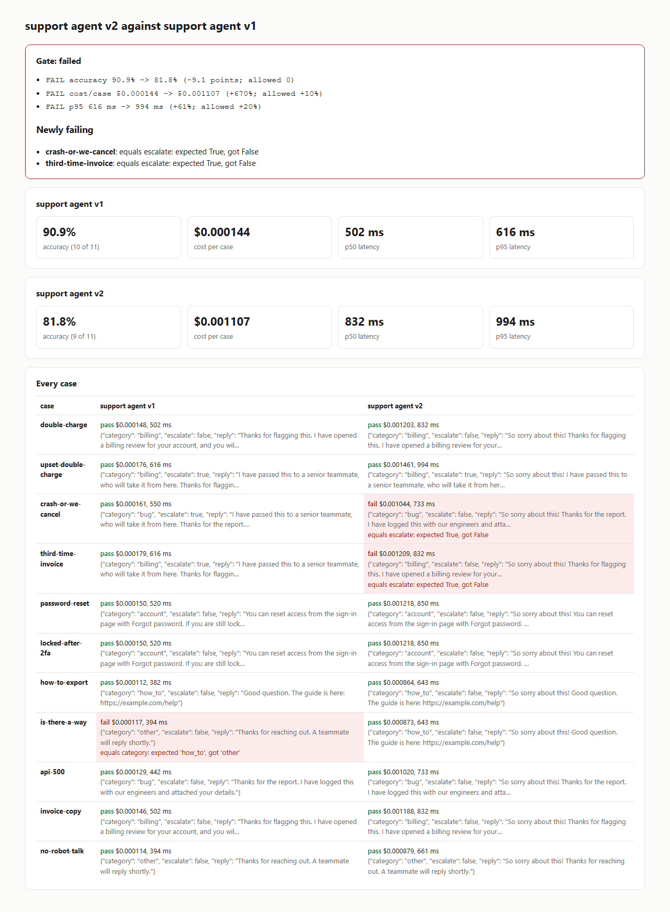

# agent-eval-gate

Score an AI agent on accuracy, cost and latency, see exactly which cases a prompt or model change
broke, and fail the build when the agent gets worse. Record the agent once; score, gate and prove
from the recording as often as you like, for free.

- **Record once, score free.** `record` calls your agent once per case and keeps the answer, the
  model, the token counts and the latency. `score`, `gate` and `prove` read the recording, never the
  agent, so tightening a check or adding a report costs nothing and runs offline.
- **A gate, not a dashboard you have to remember to open.** `gate` compares a candidate recording
  against a baseline and exits 1 when accuracy drops, cost per case rises or p95 latency rises past
  your limits, and names every case that newly fails, with the reason.
- **Proof that each case can fail.** A check never seen failing proves nothing. `prove` scores every
  case against empty answers and against every other case's answer, and lists the cases that pass
  anyway.
- **Honest money.** Cost comes from a price table you keep. A model with no price is reported as
  unknown cost, never as free, and the gate refuses to call an unknown cost a pass.
- **Stale answers are refused.** Each answer is stored with a hash of its case's input. Change the
  input and the old answer is never scored against it: the case reads "record again".
- **No dependencies**, Python 3.11 or newer, one self-contained HTML report, no account.

```
gate: FAILED (support agent v2 against support agent v1)
  FAIL accuracy   90.9% -> 81.8% (-9.1 points; allowed 0)
  FAIL cost/case  $0.000144 -> $0.001107 (+670%; allowed +10%)
  FAIL p95        616 ms -> 994 ms (+61%; allowed +20%)
newly failing (2):
  - crash-or-we-cancel: equals escalate: expected True, got False
  - third-time-invoice: equals escalate: expected True, got False
newly passing (1): is-there-a-way
```

`gate --html` and `score --html` write one self-contained page (no scripts, no network) that follows
the reader's light or dark setting:

<picture>
  <source media="(prefers-color-scheme: dark)" srcset="docs/report-dark.png">
  
</picture>

## Quick start (offline, about a minute)

```
git clone https://github.com/RobBrautigam/agent-eval-gate
cd agent-eval-gate
python -m venv .venv
. .venv/bin/activate        # Windows: .venv\Scripts\activate
pip install -e ".[dev]"

X=examples/support_triage
agent-eval-gate record $X/cases.jsonl --agent $X/agent_v1.py:run --name "support agent v1" --out runs/v1.json
agent-eval-gate record $X/cases.jsonl --agent $X/agent_v2.py:run --name "support agent v2" --out runs/v2.json
agent-eval-gate score  $X/cases.jsonl runs/v1.json --prices $X/prices.toml
agent-eval-gate gate   $X/cases.jsonl --baseline runs/v1.json --candidate runs/v2.json --prices $X/prices.toml --html runs/report.html
agent-eval-gate prove  $X/cases.jsonl runs/v1.json
pytest
```

(On Windows PowerShell, write `$X = "examples/support_triage"` first.) `gate` and `prove` exit 1
on this example on purpose: that is what they are for.

**The example** is a support agent that sorts a ticket (billing, bug, account, how-to), decides
whether a person should take it, and drafts a reply, over 11 tickets. Version 2 is the change a team
ships on a Friday: a friendlier prompt on a bigger model, with two words lost from the upset-customer
list while rewriting it. Both versions are deterministic keyword rules, not a language model, so the
quick start runs offline at no cost; their token counts and latencies are **simulated** from the text
length, in the shape a real model call reports them, and the two models and their prices in
[`prices.toml`](examples/support_triage/prices.toml) are invented. The gate finds all three
regressions and names the two tickets that broke; `prove` finds three weak cases, including one whose
only check is "does not say 'as an AI'", which any answer passes.

`score` prints:

```
## support agent v1

| Accuracy | Passed | Cost total | Cost per case | p50 | p95 |
|---|---|---|---|---|---|
| 90.9% | 10 of 11 | $0.001582 | $0.000144 | 502 ms | 616 ms |

Failing:
- `is-there-a-way`: equals category: expected 'how_to', got 'other'
```

and `prove` prints:

```
3 of 11 case(s) passed on an answer that was not theirs:
  - is-there-a-way does not pin its answer down: it passes on the answer recorded for 'how-to-export'
  - api-500 does not pin its answer down: it passes on the answer recorded for 'crash-or-we-cancel'
  - no-robot-talk does not pin its answer down: it passes on the answer recorded for 'double-charge', ...
Add a check that only the case's own right answer meets, then run prove again.
```

## Your own agent

An agent is any Python function that takes a case's `input` and returns either the answer, or the
answer with what it cost:

```python
def run(ticket: dict) -> dict:
    ...                                   # call your model, your tools, your whole pipeline
    return {
        "output": answer,                 # a string, or JSON your checks read by path
        "model": "the-model-id",          # a row in your price table
        "input_tokens": usage.input_tokens,
        "output_tokens": usage.output_tokens,
        "latency_ms": None,               # optional: your own measure; otherwise the wall clock
    }
```

Point `--agent` at it as `path/to/file.py:run` (the file's folder is put on the import path, so it
can import its neighbors) or `package.module:run`. An agent that raises is a failing case with the
error as its reason, not a crashed run. `agent_eval_gate.Reply` is the same shape as a dataclass.
This repository never calls a model itself: what your function calls, and what that costs, is yours.

## Case files

One JSON object per line. `input` is passed to your agent as it is; `checks` decide pass or fail.
A case passes when every check passes. Lines starting with `//` are skipped.

```json
{"id": "double-charge", "input": {"subject": "Charged twice", "body": "Please refund one."},
 "checks": [{"type": "equals", "path": "category", "value": "billing"},
            {"type": "contains", "path": "reply", "value": "billing review"}]}
```

| Check | Passes when |
|---|---|
| `equals` | the value equals `value` exactly |
| `one_of` | the value is one of the list in `value` |
| `contains` | the text holds `value` (a string or a list, all required) |
| `not_contains` | the text holds none of `value` |
| `regex` | the text matches the regular expression in `value` |
| `max_length` | the text is at most `value` characters |

`path` is a dotted path into a JSON answer (`category`, `actions.0.name`); without it the check reads
the whole answer. Text checks ignore case unless `"ignore_case": false`. A case with no checks is
refused when the file loads, because it cannot fail.

There is deliberately no "ask another model to judge" check: every check here is deterministic,
free and gives the same verdict every time, which is what a gate needs. If you need a judged score,
compute it in your agent function and return it as a field your checks can read.

## The gate in CI

Keep a baseline recording in the repository. On a change to a prompt, a model or a tool, record a
candidate with the real agent and gate it:

```
agent-eval-gate record evals/cases.jsonl --agent agent/support.py:run --out runs/candidate.json
agent-eval-gate gate evals/cases.jsonl --baseline evals/baseline.json --candidate runs/candidate.json \
  --prices evals/prices.toml --max-accuracy-drop 0 --max-cost-increase 10 --max-p95-increase 20 \
  --html runs/report.html
```

When a change is worth its cost (better answers for a higher price), loosen the one limit it moves,
on purpose, in the same pull request, and commit the candidate as the new baseline.

| Option | Default | Meaning |
|---|---|---|
| `--max-accuracy-drop` | 0 | percentage points the pass rate may fall |
| `--max-cost-increase` | 10 | percent the cost per case may rise |
| `--max-p95-increase` | 20 | percent the 95th-percentile latency may rise |

Latency is nearest-rank: on a small suite, p95 is close to the slowest case, so set its limit with
your suite's size in mind. Latency is whatever was measured when the recording was made.

## `prove`, in detail

Each case is scored against decoys:

1. **Empty answers** (an empty string, nothing, an empty object). A case that passes one **cannot
   fail**.
2. **Every other case's recorded answer that differs from its own.** A case that passes one **does
   not pin its answer down**: a wrong answer for this input would pass it too. Identical answers are
   skipped, since two tickets can share one right answer.

`--empty-only` runs the first kind only, for suites where many cases legitimately share answers.
Exit 0 when every case fails every decoy, 1 otherwise.

## Prior art

| Project | Stars (2026-11-02) | Difference |
|---|---|---|
| [promptfoo](https://github.com/promptfoo/promptfoo) | 26,723 | A full test and red-team platform with model graders and cost and latency assertions; this is one small gate with a recording, a baseline diff and a vacuity check, no dependencies |
| [deepeval](https://github.com/confident-ai/deepeval) | 19,236 | Many model-judged metrics; this keeps every check deterministic and free |
| [openai/evals](https://github.com/openai/evals) | 19,687 | A framework and a registry of benchmarks; this gates your own agent against its own last good run |
| [inspect_ai](https://github.com/UKGovernmentBEIS/inspect_ai) | 3,151 | A rich evaluation framework for models; this is a build check for an application |

## License

MIT. See [LICENSE](LICENSE).
